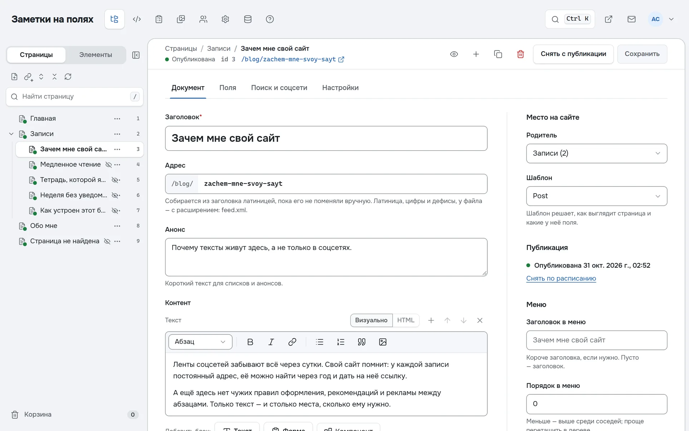
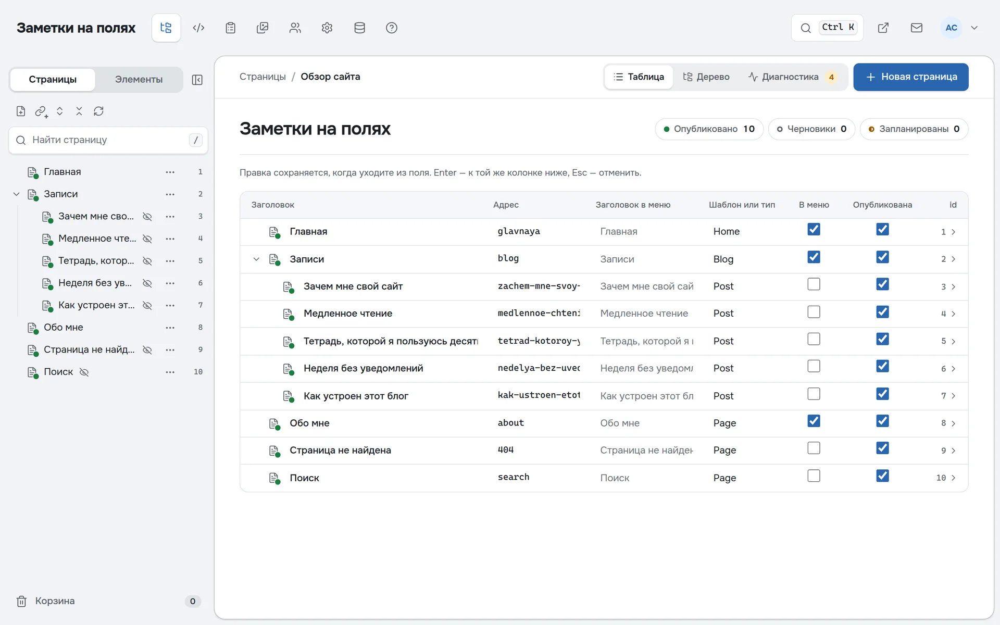

<h1 align="center">
  <picture>
    <source media="(prefers-color-scheme: dark)" srcset="docs/assets/logo-dark.svg">
    
  </picture>
</h1>

<p align="center"><strong>CMS в духе MODX Evo: просто, быстро, без лишнего.</strong></p>

<p align="center">
  <a href="https://github.com/a-sharapov/eile/releases"></a>
  <a href="https://github.com/a-sharapov/eile/actions/workflows/ci.yml"></a>
  <a href="LICENSE"></a>
  
</p>

<p align="center">
  <a href="#установка">Установка</a> ·
  <a href="#быстрый-старт">Быстрый старт</a> ·
  <a href="#документация">Документация</a> ·
  <a href="docs/README.md">Всё о внутреннем устройстве</a> ·
  <a href="CONTRIBUTING.md">Участие</a>
</p>

Дерево страниц, шаблоны и компоненты на Svelte 5, которые правятся прямо в браузере, и готовый HTML из
кэша. Весь сайт — один исполняемый файл и одна база SQLite: без PHP, MySQL, Node и Docker.

_Eile_ — по-немецки «спешка»; «Eile mit Weile» — поспешай не торопясь: сайт отдаётся мгновенно, а менеджер
спокоен.

> **Альфа-версия.** Пробовать и делать сайты можно, но до 1.0 возможны несовместимые изменения. Перед
> обновлением делайте копию: `cms backup`.

```sh
curl -fsSL https://github.com/a-sharapov/eile/releases/latest/download/install.sh | bash
cms new blog --db site.db && cms --db site.db
```

<picture>
  <source media="(prefers-color-scheme: dark)" srcset="docs/assets/manager-editor-dark.webp">
  
</picture>

## Возможности

- **Один файл.** Сервер, менеджер, компилятор Svelte, миграции и рантайм островов — в одном бинарнике.
  Страницы, элементы, медиа и пользователи — в одной базе: копия сайта — это копия файла.
- **Как в Evo.** Дерево страниц — главный инструмент, дополнительные поля назначаются на шаблоны, у каждой
  страницы id. Вместо чанков и сниппетов — компоненты Svelte: обычные импорты и выражения.
- **Быстро.** Двухфазный кэш готовых страниц сбрасывается точно по тому, что изменилось; ETag, br и gzip.
  JavaScript на странице — только в островах, которым он нужен.
- **Менеджер.** Текст страницы блоками, медиатека с уменьшенными копиями картинок, корзина, публикация по
  расписанию, переводы и свои настройки, ИИ-помощник у полей, тёмная тема.
- **Формы и заявки.** Форма — HTML5-разметка, тег `[#Form:имя]` в тексте, заявки в менеджере и уведомления
  в Telegram и на почту. Туда же приходят сообщения о сбоях сайта.
- **Находимость.** canonical, sitemap.xml, robots.txt, llms.txt, Markdown-версии страниц, постраничные
  списки с ЧПУ (`/blog/page-2`), старые адреса ведут на новые.
- **Готовые сайты.** `cms new` разворачивает блог, портфолио, сайт компании, витрину или магазин.
- **Переезд с Evo.** `cms import-evo` переносит сайт из дампа MySQL вместе с шаблонами.

<picture>
  <source media="(prefers-color-scheme: dark)" srcset="docs/assets/manager-overview-dark.webp">
  
</picture>

## Установка

```sh
curl -fsSL https://github.com/a-sharapov/eile/releases/latest/download/install.sh | bash
```

Установщик выбирает сборку под систему — Linux x64 и arm64 (glibc и musl) или macOS (Intel и Apple
Silicon), — проверяет SHA256 и кладёт `cms` в `~/.local/bin` (под root — в `/usr/local/bin`). Если
каталога нет в `PATH`, дописывает его в файл оболочки.

```sh
curl -fsSL …/install.sh | bash -s -- v0.2.0    # конкретная версия
CMS_INSTALL_DIR=/opt/bin bash install.sh       # свой каталог
CMS_NO_MODIFY_PATH=1 bash install.sh           # не трогать файлы оболочки
```

На Alpine сначала `apk add bash curl libgcc libstdc++`. Без установщика — скачайте
`cms-<система>-<процессор>.gz` со [страницы релизов](https://github.com/a-sharapov/eile/releases), сверьте
с `SHA256SUMS`, распакуйте `gunzip` и сделайте файл исполняемым.

Обновление — тот же установщик ещё раз; работающий сервер перезапустите.

## Быстрый старт

```sh
cms new blog --db site.db   # готовый сайт: blog, portfolio, company, showcase или shop
cms --db site.db            # сайт и менеджер на http://localhost:8080
```

При первом запуске сервер печатает ссылку, по которой создаётся администратор. Менеджер — `/manager`.
Пустая база начинается со страницы приветствия и пустого шаблона `Minimal`, как в Evo.

```sh
cms backup copy.db --db site.db        # копия всего сайта одним файлом
cms restore copy.db --db site.db       # восстановить из копии
cms import-evo dump.sql --db site.db   # перенести сайт MODX Evo
cms users password eile@example.com    # новый пароль, если администратор забыл свой
cms help                               # все команды с примерами
```

## Шаблоны и компоненты

```svelte
<script>
  import Menu from '$components/Menu';
  let { page, site } = $props();
</script>

<svelte:head><title>{page.title} — {site.name}</title></svelte:head>
<Menu />
<main>{@html page.content}</main>
```

Шаблоны и компоненты хранятся в базе и компилируются при сохранении: ошибка в коде не роняет сайт, он
работает на прежней версии. Вместо тегов Evo (`{{chunk}}`, `[[snippet]]`, `[*field*]`, `[~id~]`) — импорты
и выражения Svelte, данные сайта — из модуля `$core`. В «Элементах» есть набор готовых компонентов: меню,
хлебные крошки, лента с пейджером, окна.

## На сервере

Запускайте за nginx или Caddy с HTTPS и флагом `--trust-proxy`: протокол, адрес сайта и посетителя
берутся из `X-Forwarded-*`, cookie входа получает `Secure`. Без своего прокси флаг не включайте —
эти заголовки подделает любой. В «Настройках» задайте адрес сайта: по нему строятся canonical, sitemap и
проверка Origin.

Служба systemd:

```ini
# /etc/systemd/system/cms.service
[Unit]
Description=Eile CMS
After=network.target

[Service]
ExecStart=/usr/local/bin/cms --trust-proxy
Environment=PORT=8080 CMS_DB=/var/lib/cms/site.db
DynamicUser=yes
StateDirectory=cms
Restart=on-failure

[Install]
WantedBy=multi-user.target
```

```sh
sudo systemctl enable --now cms
```

## Документация

**Владельцам сайтов**

- Справка в менеджере — раздел «Помощь» (`/manager/help`): страницы, текст, медиатека, формы и заявки,
  быстрые клавиши.
- `cms help` и `cms help <команда>` — все команды с примерами.
- [Переезд с MODX Evo](docs/adr/0009-evo-import.md) и [что взято из Evo, а что изменено](docs/evo-essence.md).
- [Резервные копии](docs/adr/0015-site-backups.md) ·
  [формы и заявки](docs/adr/0021-forms.md) ·
  [уведомления в Telegram и на почту](docs/adr/0020-notify.md) ·
  [готовые сайты](docs/adr/0022-scaffolds.md) ·
  [установка и обновления](docs/adr/0023-releases-and-installer.md).

**Разработчикам шаблонов**

- [Шаблоны и компоненты из базы](docs/adr/0003-svelte-views-compiled-at-runtime.md) и
  [компоненты вместо чанков и сниппетов](docs/adr/0005-components-instead-of-chunks-and-snippets.md).
- [Глоссарий](docs/glossary.md): термины, API модуля `$core` и соответствие тегам Evo.
- [Кэш и некэшируемые регионы](docs/adr/0007-two-phase-cache.md) ·
  [острова](docs/adr/0008-islands.md) ·
  [контент из блоков](docs/adr/0010-content-from-components.md) ·
  [переводы и свои настройки](docs/adr/0013-translations-and-custom-settings.md) ·
  [страницы-файлы: CSS, RSS, robots.txt](docs/adr/0017-content-types.md) ·
  [набор компонентов и постраничные списки](docs/adr/0019-kit-and-paging.md) ·
  [находимость: SEO, sitemap, llms.txt](docs/adr/0012-discovery.md).

**Как устроено**

- [Видение](docs/vision.md) · [архитектура](docs/architecture.md) · [все решения (ADR)](docs/README.md#adr) ·
  [дорожная карта](docs/roadmap.md).

## Участие

Как собрать из исходников, запустить тесты и выпустить релиз — в [CONTRIBUTING.md](CONTRIBUTING.md).

## Лицензия

[GPL-3.0-or-later](LICENSE)
