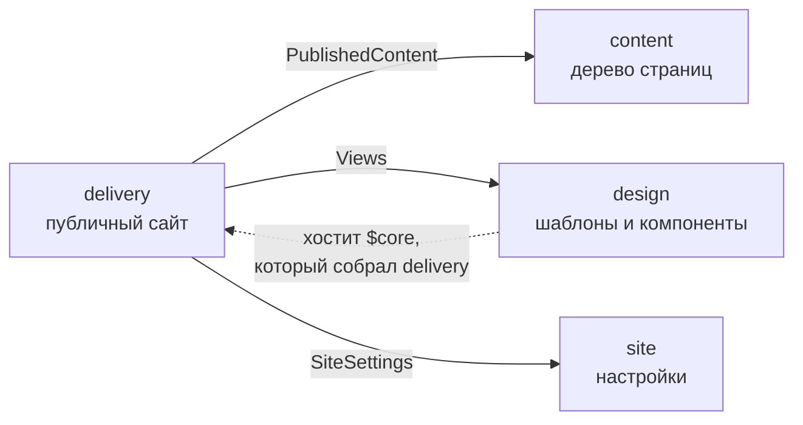
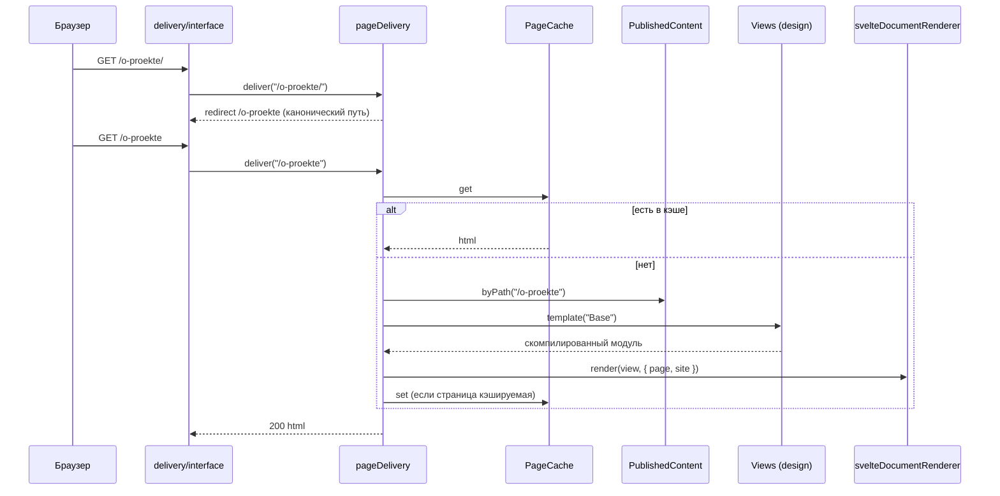

# Архитектура

CMS — **модульный монолит** в духе DDD. Каждый ограниченный контекст устроен гексагонально: домен в
центре, порты на его границе, адаптеры снаружи. Один процесс, одна база SQLite, один бинарник.
Почему так — [ADR 0002](adr/0002-ddd-modular-monolith.md). Форма кода — функциональная
([ADR 0006](adr/0006-functional-style.md), [code-style.md](code-style.md)).

## Контексты

| Контекст       | Отвечает за                                                                                 | Публичный API (`index.ts`)                                                                                                                                                                         |
| -------------- | ------------------------------------------------------------------------------------------- | -------------------------------------------------------------------------------------------------------------------------------------------------------------------------------------------------- |
| `content`      | Дерево страниц, алиасы, поля, публикация и расписание, корзина, ссылки                      | `defineContent` → `pages.{create,edit,publish,unpublish,move,setFields,trash,restore}`, `trash.empty`, `schedule.runDue`, `fields.{save,list}`, `published.{page,byPath,children,list}`, `isEmpty` |
| `design`       | Шаблоны и компоненты: хранение, проверка, компиляция, загрузка                              | `defineDesign` → `templates.save`, `components.save`, `views.template`                                                                                                                             |
| `site`         | Настройки сайта                                                                             | `defineSite` → `settings.{get,update}`                                                                                                                                                             |
| `delivery`     | Публичный сайт: канонические URL, хвост адреса порций, кэш, рендер, рантайм `$core`         | `defineDelivery` → `handle(Request)`, `cache.{stats,clear}`; `defineComponentRuntime`                                                                                                              |
| `identity`     | Пользователи менеджера, роли, сессии, первичная настройка                                   | `defineIdentity` → `setup`, `login`, `logout`, `authenticate`, `users.*`                                                                                                                           |
| `manager`      | JSON API `/manager/api`, SPA `/manager`, инструменты агента и MCP `/manager/mcp`            | `defineManager` → `handle(Request)`, `mcp(message, user)`                                                                                                                                          |
| `extensions`   | Плагины на TypeScript и их хуки                                                             | `defineExtensions` → `plugins.*`, `hooks.{render,notFound,dispatch}`                                                                                                                               |
| `media`        | Файлы сайта в SQLite, отдача `/media/*` через кэш на диске, варианты изображений            | `defineMedia` → `files.*`, `url`, `image`, `handle`, `cache.{sweep,clear}`                                                                                                                         |
| `assistant`    | Подключение ИИ (OpenAI-совместимый API), палочка у полей, памятка для моделей и цикл агента | `defineAssistant` → `connection.{status,save,remove,test}`, `generate`, `target`, `agent`; `GUIDE`                                                                                                 |
| `notify`       | Каналы Telegram и почты, очередь отправки, сбои сайта                                       | `defineNotify` → `settings.{status,save}`, `send`, `test`, `telegram.{me,chats}`, `outbox.{run,recent,bySource,retry}`, `incidents.{report,list}`, `purge`, `start`                                |
| `forms`        | Формы как HTML5-разметка, приём заявок, их хранение и обработка                             | `defineForms` → `forms.{list,get,save,remove,fieldsOf,preview}`, `render`, `submit`, `inbox.{stats,list,open,change,remove}`, `purge`, `handle`, `start`                                           |
| `certificates` | HTTPS без прокси: сертификат Let's Encrypt по ACME, его выпуск и продление                  | `defineCertificates` → `status`, `current`, `ensure`, `challenge`, `start`; `defineHttpListener`                                                                                                   |
| `search`       | Поиск по опубликованным страницам: индекс FTS5, основы слов, отрывки                        | `defineSearch` → `search`, `reindex`, `invalidate`, `rebuild`, `warm`, `handler`                                                                                                                   |
| `upkeep`       | Автокопии сайта по расписанию, проверка обновлений, `cms update`, ночная уборка             | `defineUpkeep` → `backups.{schedule,configure,run,status}`, `updates.{enabled,configure,check,latest,status}`, `start`; `updateProgram`                                                            |
| `redirects`    | Правила переадресации с адресов без страниц                                                 | `defineRedirects` → `rules.{list,create,edit,remove,import,export}`, `match`, `hit`                                                                                                                |
| `diagnostics`  | Быстрая проверка сайта: ссылки, страницы, медиа, настройки                                  | `defineDiagnostics` → `report`, `register`                                                                                                                                                         |

Все контексты — в таблице; что дальше — [roadmap.md](roadmap.md).



`delivery` — потребитель трёх контекстов. Нужные ему порты (`TemplateViews`, `DocumentRenderer`,
`PageCache`) он объявляет сам, а поставщики им структурно соответствуют. Модуль `$core` — «открытый
сервис» `delivery` для авторов компонентов. Собирает его `delivery`, а исполняет `design`, потому что именно
`design` загружает элементы.

## Слои внутри контекста

```
src/contexts/<context>/
  domain/          агрегаты, объекты-значения, доменные события, интерфейсы репозиториев; чистый TS
  application/     сценарии (команды и запросы), порты для внешнего мира; чистый TS
  infrastructure/  адаптеры: SQLite, компилятор Svelte, Bun-плагин, кэш, миграции
  interface/       входящие адаптеры: HTTP-обработчики
  index.ts         публичный API контекста и сборка его слоёв
```

## Правила зависимостей

Их проверяет `tests/architecture.test.ts` на каждом `bun run test`.

1. `domain` импортирует только свой `domain` и `shared/kernel`. Никаких пакетов, `bun:*` и `node:*`.
2. `application` импортирует только свои `domain` и `application`, `shared/kernel` и `index.ts` других
   контекстов (на практике только типы). Тоже без пакетов.
3. `infrastructure`, `interface` и `index.ts` могут импортировать что угодно из своего контекста, а также
   `platform`, `shared` и пакеты.
4. В чужой контекст можно ходить **только** через его `index.ts`.
5. `shared/kernel` импортирует только себя. `platform` не знает о контекстах.
6. Знать все контексты разрешено только корню композиции `src/app.ts`.

## Синхронные порты

`bun:sqlite` синхронный, а запрос в процессе занимает микросекунды. Поэтому репозитории и модели чтения —
**синхронные** интерфейсы. За это получаем:

- компонент берёт данные прямо в `<script>` (`children(parent)`) без `async`, `load` и водопадов;
- `nextId()` и `save()` не могут перемешаться, потому что в одном процессе между ними ничего не выполняется;
- код сценариев читается как обычная последовательность шагов.

Асинхронна только загрузка вида (`import()` модуля), и это видно в сигнатуре `design.views.template()`.

## События и согласованность

- Переход агрегата возвращает новое состояние и события (`Changed`). Сценарий сохраняет состояние и
  публикует события в `EventBus`.
- Шина синхронная и работает в процессе (`platform/event-bus.ts`).
- Подписки объявляются в `index.ts` контекстов:
  - `content` сбрасывает индекс путей на `content.*`;
  - `design` сбрасывает разрешённые виды на `design.*`;
  - `delivery` сбрасывает записи кэша по тегам события ([ADR 0007](adr/0007-two-phase-cache.md)).
  - `media` убирает из кэша на диске прежние версии файла на `media.file_saved` и `media.file_removed`.

## Конвейер запроса



## Двухфазный рендер

Первая фаза рендерит шаблон и кэшируется с тегами того, что прочитано. Вторая на каждом запросе
дорисовывает регионы `<Uncached>`. Подробно — [ADR 0007](adr/0007-two-phase-cache.md).

## Рантайм элементов

Подробности и проверенные факты — [ADR 0003](adr/0003-svelte-views-compiled-at-runtime.md) и скилл
`.claude/skills/cms-views`.

1. При сохранении `design.components.save` / `design.templates.save` проверяет имя, ищет циклы импортов
   и компилирует исходник (`svelteSourceCompiler`). Если что-то не так — `fail(…)`, и сайт продолжает
   работать на старой версии.
2. При рендере `defineViewLoader` (`design/infrastructure/bun-view-loader.ts`):
   - компилирует шаблон и его компоненты в серверные модули (`svelte/compiler`, `generate: "server"`);
   - переписывает импорты на виртуальные спецификаторы с хэшем содержимого;
   - регистрирует их через `Bun.plugin` → `build.module()`;
   - загружает модуль через `import()`.
3. `svelteDocumentRenderer` вызывает `svelte/server` `render()`, убирает маркеры гидрации и заворачивает
   результат в HTML-документ.

Каждый экземпляр приложения получает свою область спецификаторов `@cms/views-N/…`, поэтому два сайта в
одном процессе (например, в тестах) не делят виды.

## Хранилище

- Одна база SQLite: WAL, `foreign_keys = ON`.
- Таблицы принадлежат контекстам и названы с их префиксом: `content_pages`, `design_elements`,
  `site_settings`. Чужие таблицы напрямую не читаем.
- Медиатека — BLOB в `media_files`. Отдаёт её кэш на диске рядом с базой (`site.media-cache`): файл выносится
  из базы при первом запросе и уходит через sendfile. Источник — база, кэш в копию не входит
  ([ADR 0038](adr/0038-media-cache.md)).
- Миграции — SQL в TS-модулях `infrastructure/migrations.ts`. Они компилируются в бинарник, применяются при
  старте и записываются в `_migrations`. Опубликованную миграцию не меняем, только добавляем новую.

## Поставка

`bun run build` → `dist/cms`, около 105 МБ, большую часть занимает рантайм Bun. Внутри компилятор
Svelte, миграции и каркасы сайтов. `NODE_ENV` зашит как `production`.
Запуск: `cms --port 8080 --db site.db`. На пустой базе создаются страница приветствия и пустой шаблон
Minimal; готовый сайт — `cms new <каркас>` (ADR 0022). При запуске печатается
приветствие: адреса сайта и менеджера, база, сводка по страницам и ссылка первичной настройки, пока
пользователей нет. Остальные команды — `cms help`: `new` (сайт из каркаса), `info` (сводка по базе), `users` (список, `add`,
`password` — когда пароль забыт), `backup`, `import-evo`. Цвет — только в терминале; `NO_COLOR` его
выключает, `FORCE_COLOR=1` включает и в трубе.

## Каталоги

```
src/
  app.ts                корень композиции: создаёт базу, шину и контексты и связывает их
  main.ts               точка входа CLI: вызов → команда, ошибка → stderr и код 1
  cli/                  команды (serve, new, info, users, backup, import-evo), справка, цвет, MOTD
  ambient.d.ts          типы для модулей без деклараций
  shared/kernel/        pipe, Brand, fail/DomainError, Changed/chain, DomainEvent/EventBus
  platform/             SQLite и миграции, шина событий, копии сайта (archive.ts), пути импортов модулей
  contexts/<context>/   см. «Слои внутри контекста»
  scaffolds/            каркасы сайтов (блог, портфолио, компания, витрина, магазин) и приветствие
  kit/                  набор компонентов: меню, крошки, лента, окна — ставятся в элементы сайта
tests/                  интеграционные тесты через app.fetch и тест архитектуры; fixtures/demo.ts — демо-сайт
```

Доменные тесты лежат рядом с кодом (`*.test.ts`). Интеграционные — в `tests/`: они поднимают приложение в
памяти (`createApp()`) и ходят в него через `app.fetch(new Request(…))`, без сети.
